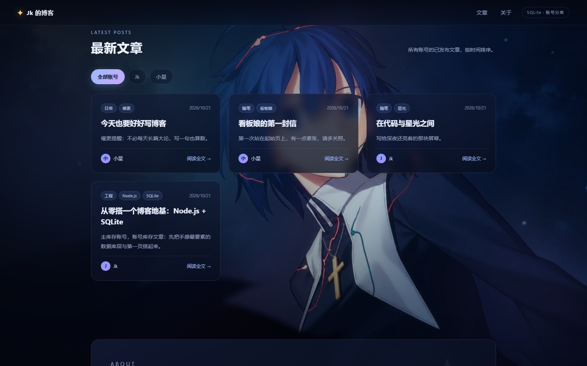
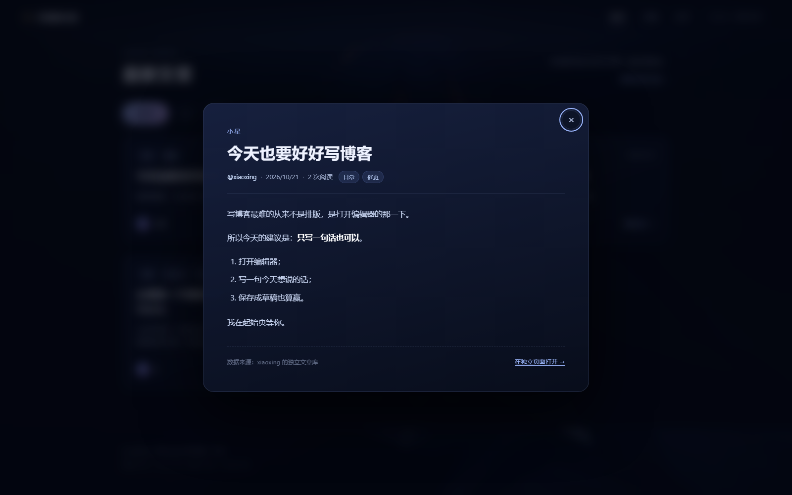
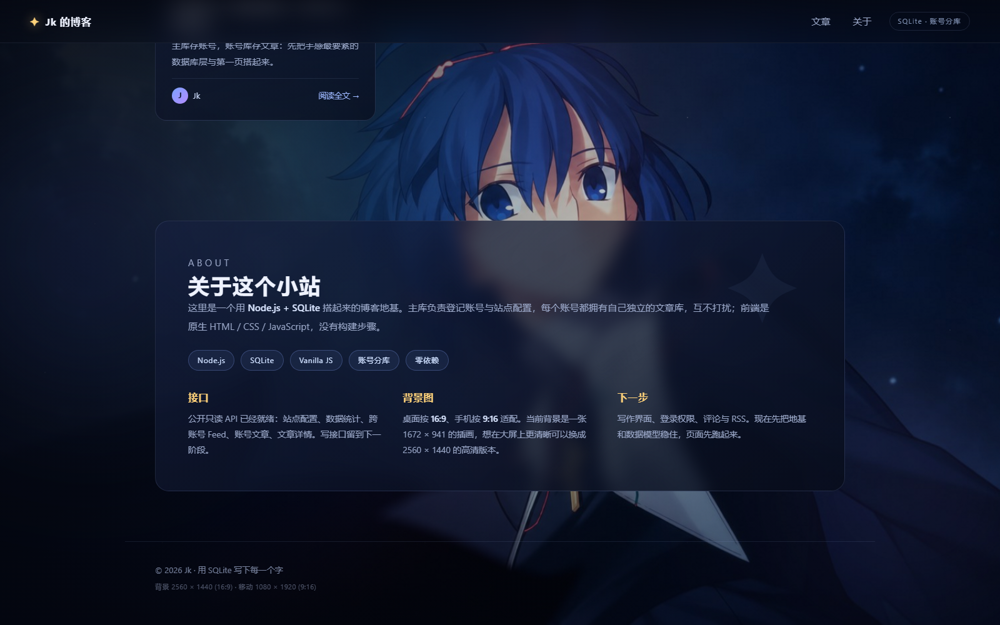

# Jk 的博客

一个从零搭起来的博客地基：**看板娘起始页（前端）+ Node.js / SQLite 后端库**。

当前阶段刻意保持简单：

- 暂时**不做登录 / 注册**。账号在这里只承担「文章分库」的职责。
- HTTP 层只开放**公开只读接口**；写文章的能力先放在后端库里（种子脚本 / 程序调用），以后要加写接口或权限时直接复用。
- 前端是原生 HTML / CSS / JavaScript，无构建步骤、无第三方依赖。
- 后端是零依赖 Node.js（使用内置 `node:sqlite`，需要 Node.js >= 22.5）。

## 预览

| 看板娘起始页 | 文章列表 + 账号筛选 |
| --- | --- |
|  |  |

| 阅读弹窗 | 关于小站 |
| --- | --- |
|  |  |

手机端：

## 快速开始

**最简单的方式**：双击项目根目录的 `启动博客.bat`。
它会自动启动服务、等待就绪并打开浏览器；会弹出一个标题为 `Jk Blog Server` 的命令行窗口，**这个窗口保持开着网站就在运行，关掉它就停止服务**（启动器窗口本身可以关）。

手动方式：

```powershell
# 1. 写入演示数据（幂等：账号已存在则跳过，已有文章则跳过）
npm run seed

# 2. 启动（默认 127.0.0.1:4173）
npm start
```

然后在浏览器打开 <http://127.0.0.1:4173/>。

> 这是一个本地运行的网站：服务没启动时，地址是打不开的。端口被占用时可以换端口启动：`$env:PORT=4180; npm start`。

其它命令：

```powershell
npm test          # 后端测试（node:test，9 个用例）
npm run dev       # node --watch 模式
npm run assets    # 重新生成占位背景（输出到 web/assets/placeholders/，不会覆盖正式背景）
```

环境变量：`PORT`、`HOST`、`BLOG_DATA_DIR`（数据目录，默认 `./data`）。

> 演示数据会创建 `jk`、`xiaoxing` 两个账号和 5 篇文章（4 篇已发布、1 篇草稿），数据落在 `data/` 下，已加入 `.gitignore`。

## 目录结构

```text
Jk/
├─ package.json
├─ server/
│  ├─ src/
│  │  ├─ index.js              # 启动入口
│  │  ├─ app.js                # 打开数据库 + 组装服务/路由
│  │  ├─ config.js             # 端口、数据目录等配置
│  │  ├─ server.js             # HTTP handler：/api/* + 静态文件 + 错误处理
│  │  ├─ lib/                  # 错误、校验、路由、静态文件等基础设施
│  │  ├─ db/                   # ★ 基础后端库：主库、账号库、文章仓库
│  │  ├─ services/             # 账号 / 文章 / 只读博客聚合服务
│  │  └─ routes/index.js       # 公开只读 API
│  ├─ scripts/seed.js          # 种子数据
│  └─ test/                    # node:test 测试
├─ web/                        # 前端（纯静态）
│  ├─ index.html
│  ├─ css/style.css
│  ├─ js/                      # api / markdown / app
│  └─ assets/                  # 背景图、favicon
├─ data/                       # 运行时数据库（git 忽略）
├─ docs/
│  ├─ data-model.md            # 数据库设计
│  ├─ api.md                   # HTTP API
│  ├─ background-spec.md       # ★ 背景图规格（含可选立绘说明）
│  └─ preview/                 # 页面截图
└─ tools/
   ├─ make_placeholder_assets.py  # 生成占位素材
   └─ capture.mjs                 # 无头浏览器截图（开发验收用）
```

## 线上部署

已经部署到 **<http://106.55.41.41/>**：Ubuntu 24.04 + systemd + nginx 反向代理，文章数据存在服务器的 SQLite 库里（`/var/lib/jk-blog/data`）。

- 部署架构与运维命令：[docs/deploy.md](docs/deploy.md)
- 服务器相关配置备份在仓库 `deploy/` 目录
- 更新线上代码：`powershell -ExecutionPolicy Bypass -File deploy\deploy.ps1`

## 数据库设计（账号分库）

一句话：**主库登记账号，每个账号拥有一个独立的 SQLite 文章库。**

```text
data/
├─ master.db                  # 主库：账号索引 + 站点配置
└─ accounts/
   ├─ account-1.db            # 账号 1 的文章库（articles 表）
   └─ account-2.db            # 账号 2 的文章库
```

- 账号之间物理隔离，互不可见；删除账号会连它的库文件一起删除。
- 备份 / 迁移可以按账号单独拿走一个 `.db` 文件。
- 主库和账号库都用 `PRAGMA user_version` 记录 schema 版本，便于以后做迁移。

完整字段与生命周期见 [docs/data-model.md](docs/data-model.md)。

## 后端库怎么用

`server/src/db/` 是纯数据访问层，`server/src/services/` 在其上做校验和业务规则。
写接口暂时没开放，但写能力已经可用：

```js
import { createApp } from './server/src/app.js';

const app = createApp(); // 默认读写 ./data，可传 { dataDir }

const account = app.services.accounts.create({
  username: 'alice',
  nickname: '爱丽丝',
  bio: '一个测试账号',
});

app.services.articles.create(account.id, {
  title: '第一篇文章',
  summary: '摘要',
  content: '# 你好\n\n正文支持 Markdown。',
  tags: ['随笔'],
  status: 'published',
});

console.log(app.services.blog.latest(6)); // 首页 Feed 用的聚合查询
app.close();
```

`BlogService` 提供只读聚合：`getSite()`、`getStats()`、`latest(limit)`、`listAccounts()`、`accountArticles(username)`、`publicArticle(username, id)`。
`ArticleRepository` / `AccountRepository` 提供底层 CRUD。

## HTTP API（只读）

| 方法 | 路径 | 说明 |
| --- | --- | --- |
| GET | `/api/health` | 健康检查 |
| GET | `/api/site` | 站点配置（标题 / 副标题 / 看板娘名字等） |
| GET | `/api/stats` | 账号数 / 文章数 / 已发布数 |
| GET | `/api/feed?limit=8` | 跨账号最新已发布文章 |
| GET | `/api/accounts` | 账号列表 + 各自文章统计 |
| GET | `/api/accounts/:username` | 单个账号信息 |
| GET | `/api/accounts/:username/articles?limit=&offset=` | 某账号已发布文章 |
| GET | `/api/public/articles/:username/:id` | 公开阅读单篇（已发布），阅读量 +1 |

错误统一为 `{ "error": { "code", "message", "details" } }`。详见 [docs/api.md](docs/api.md)。

## 前端说明

- **看板娘起始页**：全屏星空背景 + 站点标题 + 打字机问候 + 数据统计。看板娘目前以文字问候的形式出场，首页不放立绘。
- **最新文章**：跨账号 Feed；顶部胶囊可按账号筛选，对应「分库」结构。
- **阅读弹窗**：点击文章卡片，从对应账号库取回正文；内置一个安全的极简 Markdown 渲染器（先整体转义，再渲染）。
- **文章深链**：`/?post=xiaoxing:1` 可直接打开某篇文章。

替换素材（保持同名即可生效）：

| 文件 | 用途 | 说明 |
| --- | --- | --- |
| `web/assets/hero-bg.jpg` | 桌面背景 | 当前为 1672 × 941（16:9）的插画；有更高清原图时建议换成 2560 × 1440 |
| `web/assets/hero-bg-mobile.jpg` | 手机竖屏背景 | 1080 × 1920（9:16），由同一张插画裁切生成 |

> 看板娘立绘当前**未使用**（已移除 AI 生成的占位立绘）。如果以后要加，参考 [docs/background-spec.md](docs/background-spec.md) 里保留的立绘规格，并恢复 hero 右侧的立绘位。

详细要求（安全区、格式、体积、构图建议）见 [docs/background-spec.md](docs/background-spec.md)。

## 测试与验收

```powershell
npm test
```

覆盖：主库/账号库 schema 与版本、账号隔离、文章 CRUD、slug 唯一、发布状态、阅读量、输入校验、账号删除连带删库、HTTP 只读接口、静态资源与目录穿越防护。

页面验收截图在 `docs/preview/`，由 `tools/capture.mjs`（Chrome DevTools Protocol）生成，可复用：

```powershell
# 先起服务，再用带 --remote-debugging-port 的 Edge/Chrome 打开 about:blank，然后：
node tools/capture.mjs "docs/preview/feed.png" "http://127.0.0.1:4173/" --scroll="#feed"
```

## 下一步

1. 写作界面 + 写接口（`POST/PATCH/DELETE /api/articles`），沿用现有 `ArticleService`。
2. 登录 / 权限（届时主库账号表加密码或接第三方登录；文章库结构不用动）。
3. 文章详情独立页面 / SEO / RSS。
4. 分类、标签页、全文检索（SQLite FTS5）。
5. 评论、图片上传与图床。
